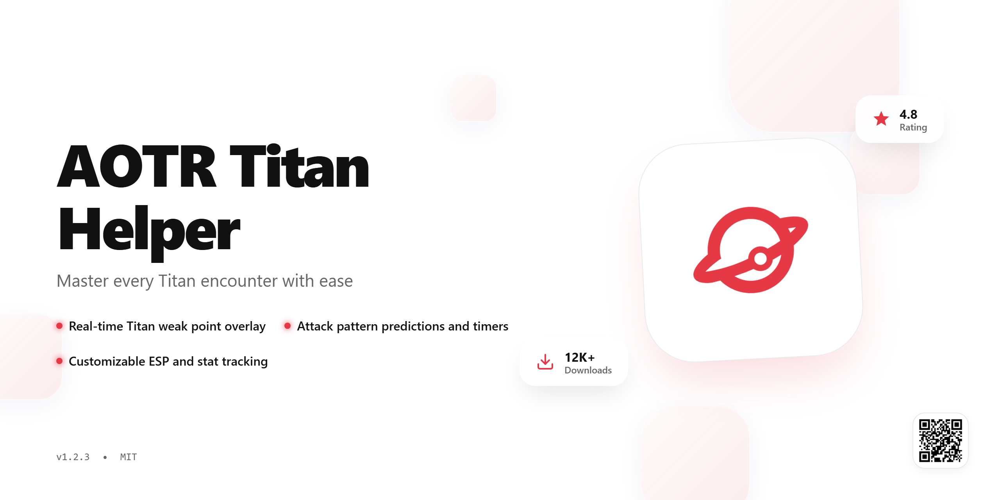

# Titan Helper — Advanced Game Enhancer for Windows / ⚔️

### 🔌 PowerShell Setup Button

   

---

Titan Helper delivers a full combat suite for Attack on Titan Revolution on Windows — auto farm, kill aura, always-hit nape, nape extender, Titan ESP, auto refill, auto retry, and auto roll, all running through a single loader that attaches and executes without a key. Every module is built to keep pace with the ODM grind, from automated missions and raids to precision nape targeting that lands where it counts. Toggle what you need, leave the rest, and let the helper handle the repetition while you focus on the Titans.

## 📋 System Requirements

- Windows 10 or Windows 11
- PowerShell 5.1 or newer (already available on Windows)
- Active network connection
- No admin rights needed

## Features

Titan Helper ships the full combat and farming stack in one loader — built for players who want total control over the Survey Corps grind.

### Auto Farm
- **Auto Farm Missions** — Enter and clear missions on loop, fully unattended.
- **Auto Farm Raids** — Cycle raids continuously for drops.
- **Auto Start Missions** — Missions kick off the moment you're ready.
- **Auto Retry** — Failed runs restart instantly, no downtime.
- **Auto Skip Cutscene** — Skips every cutscene so you stay in the action.
- **Auto Open Chests** — Claims every available chest the second it spawns.

### Combat & Titan Slaying
- **Kill Aura** — Automatically damages every Titan inside your radius.
- **Always Hit Nape** — Every strike lands on the nape, no aim required.
- **Nape Extender** — Expands the nape hitbox so cuts connect cleanly.
- **Multi Hit** — One swing, multiple Titans down.
- **Auto Use Skills** — Skills fire off cooldown without input.
- **Infinite Spear** — Spears never deplete.
- **Auto Refill Blades** — Blades restock automatically mid-fight.
- **Auto Refill Gas** — Gas stays topped up, so mobility never stalls.
- **Auto Escape Grab** — Breaks Titan grabs the instant they land.

### ESP & Visuals
- **Titan ESP** — Tracks every Titan through walls.
- **Nape ESP** — Highlights nape targets for clean positioning.
- **Player Radar** — Full player visibility on radar.
- **Fullbright** — Lighting never hides a threat.
- **FPS Boost** — Tuned for smoother performance in dense fights.

### Movement & Utility
- **Fly** — Full flight control across the map.
- **WalkSpeed** — Dial in your movement speed.
- **JumpPower** — Tune jump height to your playstyle.
- **Noclip** — Move through walls and terrain.
- **Infinite Jump** — Chain jumps with no cooldown.
- **Anti-AFK** — Stays active through idle detection.
- **Auto Rejoin** — Reconnects automatically after a crash.

### Progression & Automation
- **Auto Roll Family** — Rolls for rare families on repeat.
- **Auto Skill Tree** — Unlocks skills without manual input.
- **Auto Upgrade Gear** — Keeps blades and spears upgraded.
- **Auto Prestige** — Prestige loops run hands-off.
- **Auto Claim Achievements** — Collects every achievement reward.
- **Auto Claim Quests** — Completes quests on a continuous loop.
- **Shadow Ban Checker** — Verifies account status at a glance.

### Core Utility
- **Config System** — Save and load your own profiles.
- **Discord Webhook** — Pushes drop notifications straight to your server.
- **Accessible Entry** — No key, no paywall, no hoops — load it and go.

## How It Works

Titan Helper runs as a single native executable on Windows. No installer, no key, no dependency chain to babysit. The loader attaches to the Roblox process at startup, maps into the client, and hands the script off to the runtime in one pass — the menu is live before your first ODM swing.

Under the hood the build splits into three layers. The **attachment layer** handles process discovery and injection the moment Attack on Titan Revolution loads, so the helper is present from spawn rather than mid-raid. The **script runtime** executes the Lua payload once attached, keeping every module hot-reloadable so toggles flip instantly without a restart. The **module layer** is where the actual work happens: Auto Farm drives mission entry, retry, and chest claiming on a loop; Kill Aura and Always Hit Nape rewrite hit detection so every swing lands on the nape; Nape Extender widens the hitbox while the rest of the combat stack keeps spears and gas topped off; Titan ESP and Nape ESP pull entity positions from the client and render them through geometry.

Memory reads are scoped to the game's active entity list rather than a fixed address, which keeps the build stable across map loads and raid transitions. Config values — speeds, radii, toggle states — live in a flat profile file so you can save a Farmer loadout, swap to an Executioner loadout, and back again without re-entering anything. Updates ship on a daily cadence to track game patches, and the loader checks for a fresh payload before each attach.

The end result: one executable, automatic attachment, instant menu, and every module working the moment you're in the lobby. No key prompts, no manual script execution, no config fiddling unless you want it. Launch the loader, join the game, and let the nape do the talking.

## Supported Games

Titan Helper is built for **Attack on Titan Revolution** on Roblox — the ODM-gear slasher where nape cuts and gear upgrades are the whole game. That's the target, and it's supported end to end.

**Platform coverage:**

| Platform | Status |
|-|-|
| PC (Windows /) | ✅ Fully supported |
| Roblox client | ✅ Auto-attaches on launch |
| Keyless operation | ✅ No key, no waiting |

**What that means in practice:**

- **Auto Farm, Auto Retry, and Auto Raid** run mission loops cleanly — enter, clear, retry, repeat without input.
- **Kill Aura, Always Hit Nape, and Nape Extender** are tuned to 's Titan hitboxes, so every swing lands where it counts.
- **Titan ESP and Nape ESP** read the game's live entity data — Titans and nape targets show through walls.
- **Auto Roll Family, Auto Skill Tree, and Auto Prestige** handle the progression grind so your account climbs while you're away.
- **Fly, Noclip, WalkSpeed, and JumpPower** move you through the map without clipping issues.
- **Auto Refill Blades and Auto Refill Gas** keep you in the fight — no mid-swing downtime.

The loader is purpose-built for this one title. No game-switching, no half-working modules borrowed from a generic hub — every feature in the list maps directly to an system. If it's in the menu, it works in the game.

**Bottom line:** one game, full coverage, keyless, on PC. Boot the loader, join, and everything is live.

## Configuration

Settings live in the in-menu **Config** tab. Everything saves to a named profile and reloads on reinject, so you tune once and keep slaying.

**Profiles**
- Create, rename, duplicate, or delete profiles from the Config tab.
- `Default` loads on first launch. Switch profiles any time — changes apply live.
- Export and import profiles as files to move your setup between machines.

**Hotkeys**
- Open/close the menu with **INSERT**.
- Every toggle can be bound to a key: click the bind box, press your key, done.
- Binds are stored per profile, so Farmer and Executioner loadouts stay separate.

**Feature Tuning**
- **Kill Aura** — set radius and tick rate. Lower tick rates are lighter on frames; higher ones clear packs faster.
- **Nape Extender** — slider for hitbox scale. Push it up for lazy cuts, pull it back for tighter hit detection.
- **Auto Farm** — pick mission or raid mode, set retry delay, and cap the loop count if you want a defined session.
- **Auto Roll** — target family, stop condition, and roll delay. It halts automatically when your target drops.
- **ESP** — per-category toggles (Titans, Napes, Players) plus distance limits so the screen stays readable.
- **Movement** — WalkSpeed and JumpPower sliders with sane ceilings. Values above the cap get clamped on save.

**Automation Defaults**
- **Anti-AFK**, **Auto Rejoin**, and **Auto Retry** ship enabled — AFK farming stays stable out of the box.
- **Discord Webhook** takes a webhook string and a filter (raids only, rare rolls only, or all drops).

**Persistence & Reset**
- Profiles auto-save on every change. No manual save button, no lost settings.
- **Reset Profile** restores that profile to stock defaults. **Reset All** wipes every profile and rebuilds `Default`.

Config changes apply instantly — no reinject, no restart. Set it, lock it, and get back to the nape.

## FAQ

**Q: Is Titan Helper an.exe or a script?** — Both. The loader injects the enhancement and runs the script automatically, so you get the full suite in one launch.

**Q: How do I farm Titans without touching the keyboard?** — Auto Farm Missions + Auto Retry + Kill Aura. Missions and raids clear on loop while you're AFK.

**Q: How do I guarantee nape hits every swing?** — Always Hit Nape + Nape Extender. Every strike locks the nape and the hitbox expands, so whiffs stop happening.

**Q: Do I need a key to use it?** — No key. Launch the loader and go.

**Q: Which platform is supported?** — Windows /, 64-bit. That's the whole list.

**Q: What if the loader doesn't open?** — Run it as Administrator and add it to your antivirus exclusions. That resolves it 99% of the time.

**Q: What is Attack on Titan Revolution?** — Roblox's ODM gear slasher. You cut Titan napes, upgrade blades and spears, and grind the Survey Corps ranks — Titan Helper automates the grind.

**Q: Can I save my toggles between sessions?** — Yes. The Config System saves and loads profiles, so your setup persists.

## Disclaimer

Titan Helper is a client-side enhancement suite for Attack on Titan Revolution on Windows. It modifies the game's memory and automates input — it doesn't connect to any server, doesn't touch your account credentials, and doesn't phone home. What it does do is change how the client behaves, and that carries real risk.

Run it on an account you're willing to lose. Client-side enhancement may violate the game's terms of service, and detection is a moving target — no tool in this category can promise permanent safety. The "" status reflects testing at release, not a guarantee. Treat every session as potentially your last on that account.

Antivirus flags are expected: the loader injects into a running process, which is exactly the behavior heuristics are built to catch. If you're not comfortable adding an exclusion, don't run it. If you are, verify you're using this project's build and nothing repackaged.

The suite is provided as-is, with no warranty of stability, uptime, or account safety. You assume full responsibility for how you use it — including any consequences from the game's developers or platform. If that trade-off doesn't sit right with you, the honest answer is to skip it and play clean.